# HextGen Automation Suite: ClaimPilot + Receivables + Onboarding Copilot

> A working prototype built for the **AI Automation Intern** role at HextGen AI MedTech.
> It covers all three responsibilities in the job description in one runnable system:
> **hospital onboarding automation**, an **AI layer on Gemini 2.5 Flash**, and **cross-application RPA** for insurance/TPA claims.
> It also shows how it would plug into an HMS's IPD module: a REST call in, signed webhooks out, with a Node.js reference client.

## ▶ Demo (2:48)

[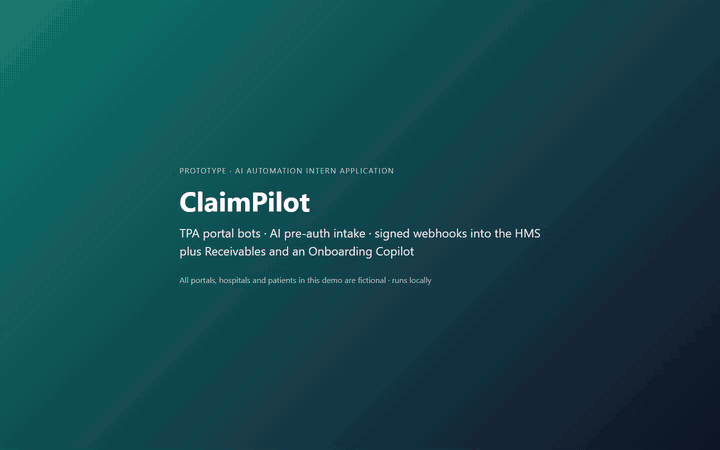](docs/demo.mp4)

*Above: the whole demo at 4× speed. **[Watch the full-speed captioned video (MP4, 2:48)](docs/demo.mp4)**.*
It shows the bots syncing three portals, signed events reaching the HMS, a human typing the OTP, a drafted TPA reply that
can't be sent with placeholders, AI intake, receivables and onboarding. In this recording the AI steps run on the
rules engine; the Gemini 2.5 Flash results are in [Evals and tests](#evals-and-tests).

**Read first:** [What's real and what's mocked](#whats-real-and-whats-mocked) · [Integration with the HMS](#integration-with-the-hms)

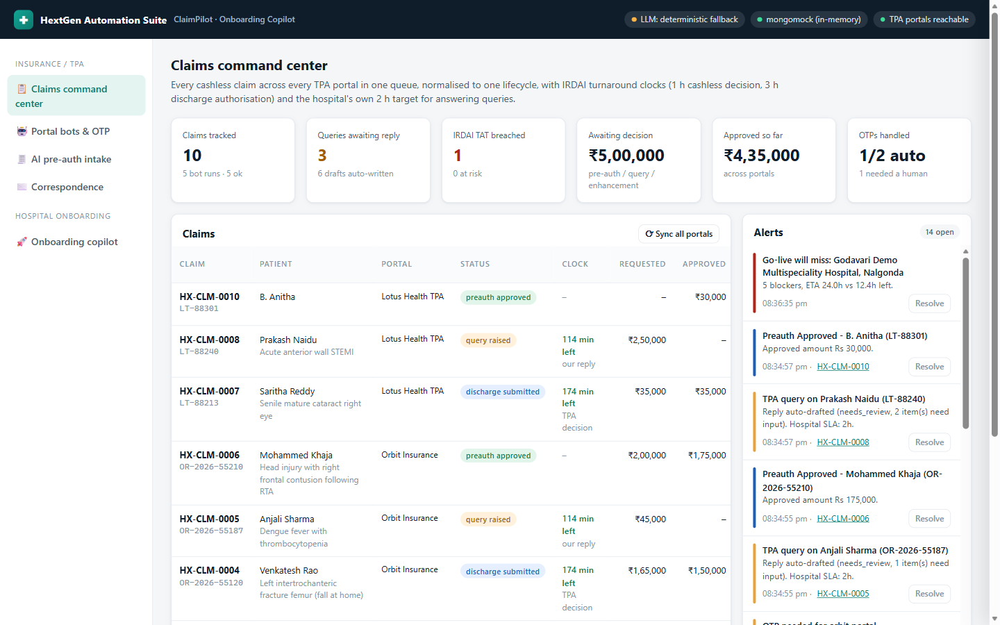

## Why this project

HextGen's Hospitals plan lists *"Insurance claims and TPA support"* and IPD billing *"with insurance and packages"*.
The AI Automation Intern posting asks for onboarding a hospital in under 24 hours and an insurance claims automation
pipeline. Behind both sit the same kinds of manual work at every hospital:

* **The TPA desk** logs into 5-10 insurer/TPA portals a day. Each portal has a different layout, an OTP on someone's
  phone, and a different word for "query raised". Staff copy statuses into a register and answer the same predictable
  queries again and again: *"duration of ailment?", "alcohol history?", "MLC copy?", "implant sticker?"*.
  Under the IRDAI Master Circular (29-May-2024), insurers must decide cashless requests within **1 hour** and final
  discharge authorisation within **3 hours**, but nobody on the hospital side is watching those clocks.
* **Onboarding** a new hospital means cleaning its Marg/Excel/legacy-HMS exports (drug master, staff, lab rates,
  tariff) row by row. Then comes chasing the hospital for missing doctor registration numbers, a rejected WhatsApp
  template, or a GSTIN typo. Each of those quietly pushes go-live past 24 hours.

This repo automates both, with the safety properties a healthcare company needs:
the AI never invents a clinical fact, and every bot action is audited.

## What maps to the JD

| JD responsibility | What's built here |
|---|---|
| **1. Onboarding blocker automation**: data migration, config, staff setup, go-live checks, monitoring | **Onboarding Copilot**: detects each file's type, maps messy columns (`Exp`, `P.Rate`, `Mfr`, `Reg. No`), normalises Indian formats and validates against GST, clinical and login rules. It scores go-live readiness against the deadline (ETA vs hours left), raises alerts *before* the deadline slips, and outputs a row-wise fix-list CSV, import-ready CSVs and a drafted message to the hospital admin. |
| **2. AI layer for existing features**: Gemini 2.5 Flash via Vertex AI, accuracy and safety evaluation | **AI pre-auth intake**: Gemini extracts 24 pre-auth fields from case sheets, PDFs or images, and a **grounding check** verifies every value against the source. A **query-risk screen** predicts the TPA's queries before submission. `evals/` measures field accuracy, hallucination rate and safety-gate red-team cases. |
| **Revenue cycle**: the month-end blind spot | **Receivables tracker**: money owed per payer (private TPAs, Aarogyasri, EHS, PM-JAY), grouped by how long it has been unpaid (0-30 / 31-60 / 61-90 / 91-180 / 180+ days), with deductions and denials grouped by reason. It sends the owner a **daily WhatsApp summary** covering what came in, what was denied, what needs a reply, and which payer's data is stale. Private TPA claims flow in from the bots at discharge. The government schemes come in by CSV upload or manual entry. |
| **3. Cross-application automation**: LLM correspondence, portal login and navigation, OTP flows, status into a queryable store, fallbacks for manual review | **ClaimPilot**: Playwright bots for 3 deliberately different portals. An **OTP ladder** tries the SMS forwarder first, then asks a human on the dashboard, then routes the claim to manual review. Statuses are normalised into one lifecycle in MongoDB with an event log. TPA query letters are fetched and a point-wise reply is **auto-drafted**. Escalation emails are drafted when IRDAI timelines are breached. |

## Screenshots

| | |
|---|---|
| 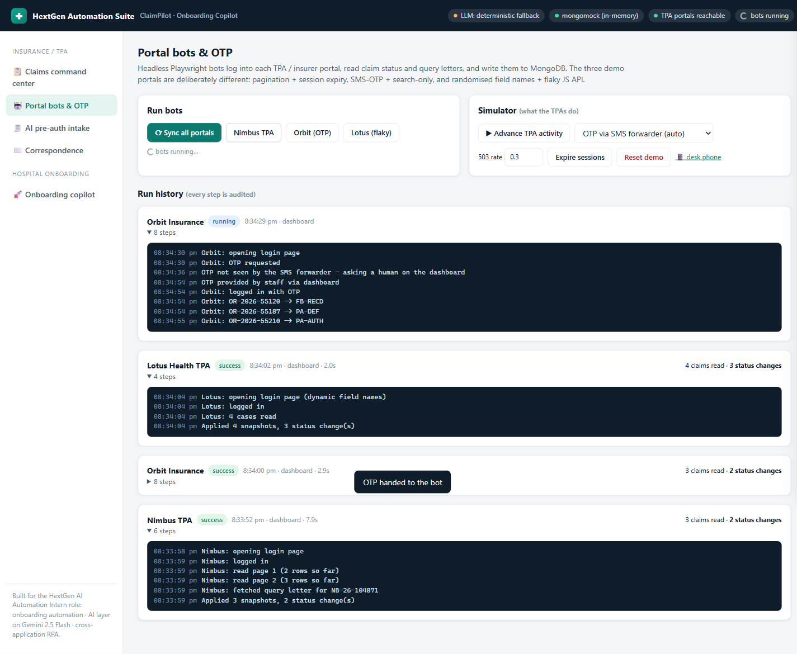 **Portal bots**: every step audited; the Orbit run shows the human-OTP fallback | 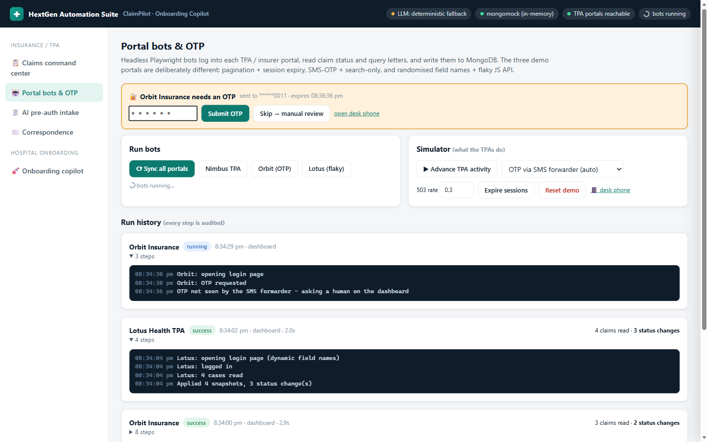 **OTP human-in-the-loop**: the bot waits while staff type the OTP |
| 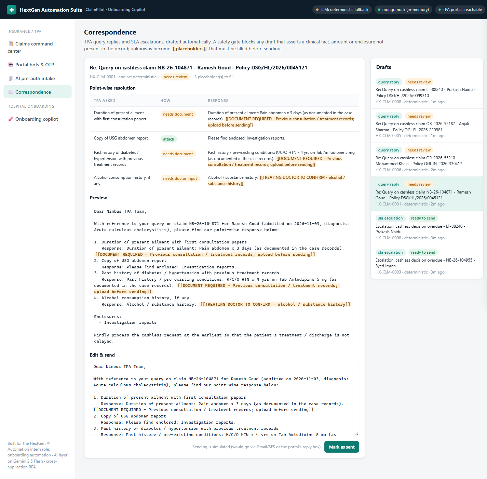 **TPA query reply**: answered from the record, attachments matched, unknowns left as `[[placeholders]]` | 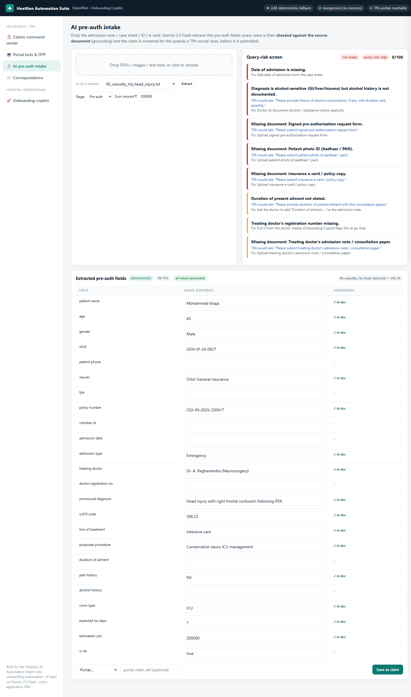 **AI intake**: grounding badges plus the queries the TPA *would* raise |
| 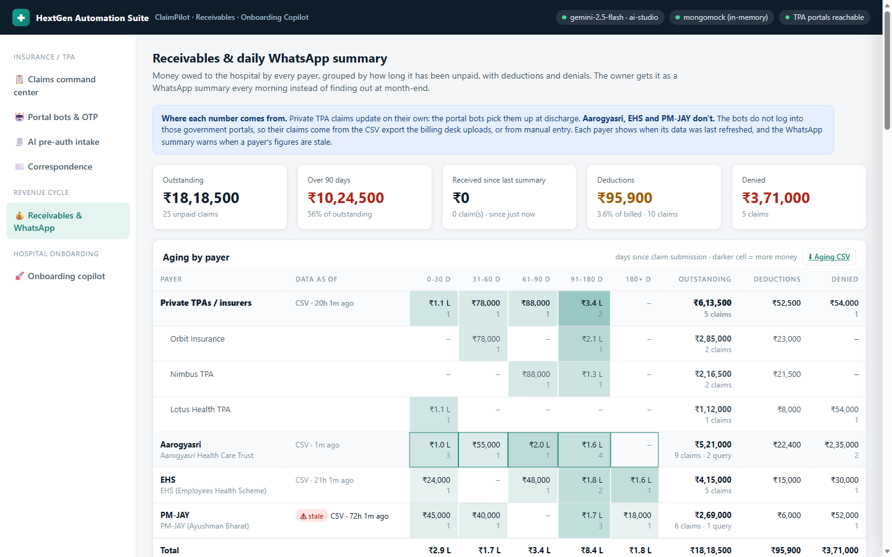 **Receivables**: aging per payer, data freshness per payer, deductions and denials by reason | 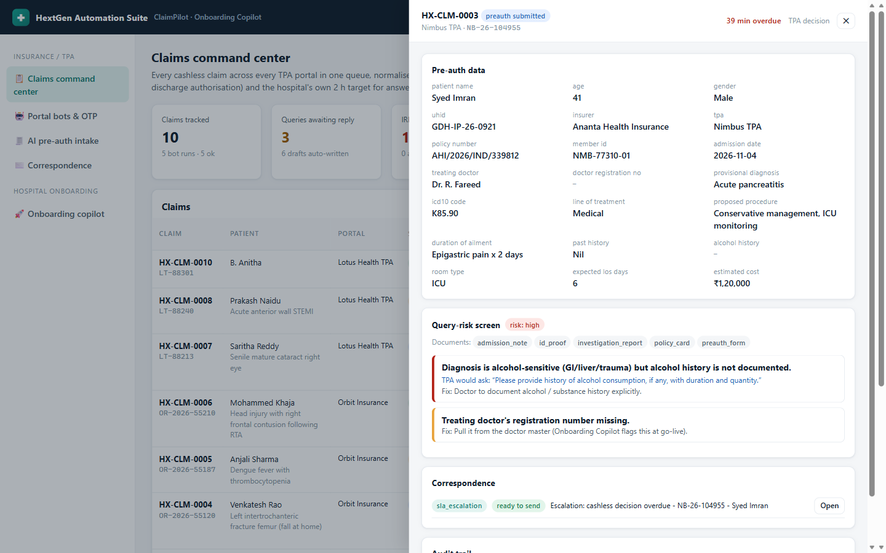 **Claim drawer**: pre-auth data, risk screen, correspondence, audit trail |
| 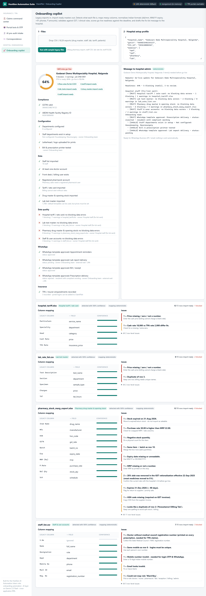 **Onboarding Copilot**: readiness vs deadline, mapping confidence, row-level issues | |

## Run it (about 2 minutes, no API keys or database needed)

```bash
uv sync
uv run playwright install chromium

# terminal 1: three fictional TPA portals for the bots to drive
uv run uvicorn mock_portals.server:app --port 8100

# terminal 2: API + dashboard
uv run uvicorn app.main:app --port 8000
# open http://127.0.0.1:8000
```

With no keys, every AI feature runs on its **deterministic engine**: rules, regex and templates. The UI shows which
engine produced each output. To switch on Gemini 2.5 Flash:

```bash
cp .env.example .env
# Vertex AI (the stack named in the job posting):  GOOGLE_GENAI_USE_VERTEXAI=true  GOOGLE_CLOUD_PROJECT=<project>
#   and run: gcloud auth application-default login
# or AI Studio:                 GEMINI_API_KEY=<key>
```

Transient Gemini errors (429 quota, 5xx overload) are retried using the delay the API asks for, capped by
`LLM_RETRY_BUDGET_S` (default 30 s, so the dashboard never hangs). If the budget runs out, the feature falls back to the
deterministic engine. The AI Studio free tier allows 5 requests a minute and 20 a day per model, and one eval run makes
11 calls.

Re-record the captioned demo video: `uv run python -m scripts.record_demo` (add `--gemini` to run the AI steps on
Gemini). It writes `prep/demo.mp4`; copy that over `docs/demo.mp4` to update the video linked at the top.

Real MongoDB: set `MONGODB_URI=mongodb://localhost:27017`, or run `docker compose up` for MongoDB, portals and app together.

### 5-minute demo script

1. **Command center**: 9 seeded claims. Two are already past the IRDAI 1-hour clock, and escalation emails are pre-drafted.
2. **Sync all portals**: watch the bots log in, paginate, auto-read the OTP and fetch query letters.
   The claims flip to *query raised*, *partially approved* and *denied*, and a claim found on the portal but missing
   from the HMS raises an alert.
3. **Correspondence**: open the Nimbus query for Ramesh Goud. Duration and past history are answered from the record,
   the USG report is attached, and alcohol history becomes a `[[TREATING DOCTOR TO CONFIRM]]` placeholder.
   *Mark as sent* is refused until the placeholders are filled.
4. **Portal bots, Simulator**: switch OTP to *desk phone (human)*, click **Advance TPA activity**, then sync Orbit.
   An OTP card appears; copy the code from the 📱 desk phone link into it, and the bot carries on.
   Set the 503 rate to 0.6 to watch backoff retries on Lotus.
5. **AI intake**: extract `06_casualty_rta_head_injury.txt`. It's flagged as alcohol-sensitive trauma with no alcohol
   history: exactly the query Orbit raises later.
6. **Receivables & WhatsApp**: about ₹21.8 L is outstanding across four payer types, and 58% of it is over 90 days old. PM-JAY is flagged
   *stale* because its export is 3 days old. Click **Upload today's sample Aarogyasri export**: 3 claims are marked paid (₹2,43,600),
   one is denied, and a new consumables deduction appears. The WhatsApp preview's "since the last summary" section updates to match. **Send now** writes
   to the outbox (dry run) unless WhatsApp Cloud API keys are set.
7. **Onboarding copilot**: *Run with sample legacy files*. It finds 6 blocking rows in the Marg export (expired stock,
   MRP below purchase rate, duplicate batch...). It also finds a doctor without a registration number, a duplicate
   login phone, a rejected WhatsApp template and an extra zero in a tariff, and it predicts the go-live will be missed.

## Architecture

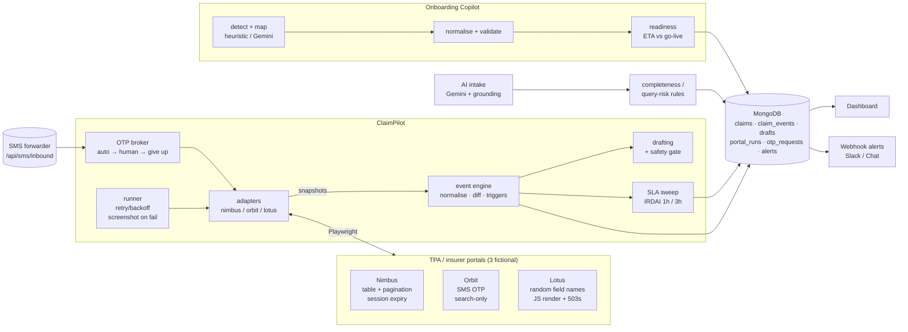

## What's real and what's mocked

A reviewer should know exactly what this prototype proves and what it doesn't.

| Part | Status |
|---|---|
| **TPA portals** (Nimbus, Orbit, Lotus) | **Mocked.** Fictional portals I built to reproduce the failure patterns real portals have: OTP on a desk phone, pagination, session expiry, randomised field names, JS-rendered tables, random 503s. **No real TPA portal (Medi Assist, FHPL, Paramount, Vidal, etc.) has been driven.** Real portals add captchas, terms-of-use limits and layouts I haven't seen. Each real portal is one new adapter in `app/portals/`. |
| **Government schemes** (Aarogyasri, EHS, PM-JAY) | **Not scraped, by design.** Claims come in via the CSV export the billing desk already downloads. The export column layouts are **assumed** and need checking against real exports. |
| **Bot engine** (retries, OTP fallback chain, failure taxonomy, idempotent sync, status normalisation) | **Real and tested.** 6 tests drive real Chromium against the mock portals. |
| **Gemini 2.5 Flash extraction** | **Real.** Run live against `gemini-2.5-flash`. The 6 gold documents are synthetic, so this is a small-sample signal, not a benchmark. |
| **Safety gate, grounding check, completeness rules** | **Real and tested.** The TPA query rules come from public TPA and IRDAI material and haven't yet been checked with a hospital TPA desk. That check is planned: [`docs/field_validation.md`](docs/field_validation.md). |
| **Onboarding Copilot** | **Real logic, assumed targets.** Column mapping, validation and readiness scoring work. The target schemas in `onboarding/schemas.py` are my guess at an HMS import format, not HextGen's real one. |
| **HMS integration** (REST in, signed webhook out) | **Real and tested** against the Node.js reference receiver in `integrations/hms-node/`. The admission payload shape is illustrative. HextGen's real IPD data model would replace it. |
| **WhatsApp Cloud API** | Mocked HTTP test only. Not yet sent to a real number, and the template hasn't been through Meta's approval. |
| **MongoDB** | Developed on mongomock. Not yet run against a real MongoDB server. |
| **Data** | Every hospital, patient, insurer, TPA, policy and case number is fictional. |

## Integration with the HMS

ClaimPilot is built to sit **beside** an HMS, not replace any of it. The HMS stays the system of record for the
admission and the bill. ClaimPilot owns the portal work and tells the HMS what changed.

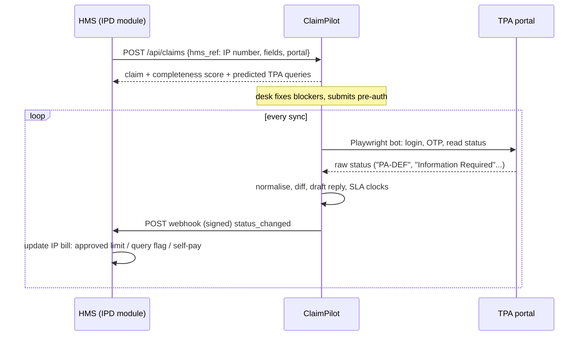

**Into ClaimPilot** (what the IPD module calls when an insured patient is admitted):

| Call | Purpose |
|---|---|
| `POST /api/claims` with `hms_ref` | Create the claim from the admission. `hms_ref` (e.g. the IP number) is an idempotency key: a retried call returns the same claim. Returns the completeness score, blockers and the TPA queries the claim is likely to get. |
| `GET /api/claims/by-hms/{hms_ref}` | Look a claim up by the HMS's own reference. |
| `POST /api/claims/{id}/documents` | Tell ClaimPilot a document was uploaded in the HMS (re-scores completeness). |
| `POST /api/extract` | Optional: send the case sheet and get the 24 pre-auth fields back, with grounding flags. |

**Out of ClaimPilot** (`app/hms_webhook.py`): every claim event (`created`, `status_changed`, `documents_added`,
`correspondence_sent`) is POSTed to `HMS_WEBHOOK_URL`:

```json
{"event_id": "6729f1...", "kind": "status_changed", "claim_id": "HX-CLM-0002", "hms_ref": "IP-2026-00451",
 "status": "PARTIALLY_APPROVED", "approved_amount": 45000,
 "data": {"from": "PREAUTH_SUBMITTED", "to": "PARTIALLY_APPROVED", "raw": "Partially Approved", "portal": "nimbus"},
 "at": "2026-11-05T04:24:51+00:00"}
```

* **Signed:** `X-ClaimPilot-Signature: sha256=<HMAC of the raw body with HMS_WEBHOOK_SECRET>`.
* **Durable:** every event is written to the `hms_outbox` collection first. A failed delivery is retried with
  exponential backoff (30 s up to 1 h, 8 attempts), and `GET /api/hms/outbox?undelivered=true` shows what's stuck.
* **Ordered per claim:** while an older event for a claim is undelivered, newer ones for that claim wait, so the
  HMS never sees "approved" before "query raised".
* **Idempotent:** the receiver dedupes on `event_id`.

**Node.js reference** ([`integrations/hms-node/`](integrations/hms-node/)), with no dependencies, since an HMS team on a
MERN stack would own this side:
* `claimpilot-client.js`: maps an IP admission to a claim and calls the API.
* `webhook-receiver.js`: verifies the signature with `timingSafeEqual`, dedupes, and maps each status to an IPD
  billing action, for example `DENIED` → *switch the bill to self-pay / reimbursement*.

```bash
# terminal 3: HMS side
cd integrations/hms-node && HMS_WEBHOOK_SECRET=s3cret node webhook-receiver.js
# start the app with: HMS_WEBHOOK_URL=http://127.0.0.1:8300/claimpilot HMS_WEBHOOK_SECRET=s3cret
node claimpilot-client.js        # creates a claim from a sample admission, retries it, prints predicted queries
```

Then press **Sync all portals**. The receiver prints one line per status change, for example
`HX-CLM-0009: PREAUTH_SUBMITTED -> DENIED => switch the IP bill to self-pay / reimbursement and inform the patient`.

## Design decisions worth reviewing

**AI where it helps, rules where it must be exact.**
* Every LLM feature has two implementations: Gemini with structured JSON output against a Pydantic schema, and a
  deterministic fallback (`app/llm.py::run_with_fallback`). An LLM outage never stops the TPA desk, and the evals
  get a baseline to beat.
* The completeness check and query-risk screen are deliberately **rules, not LLM**. They must be explainable and
  auditable, and they encode domain knowledge: alcohol-sensitive diagnoses, MLC on accident cases, implant stickers,
  maternity waiting periods, and room-rent proportionate deduction.

**Grounding check on extraction** (`claims/extraction.py`). After Gemini extracts the fields, every value is searched
for in the source text, using fuzzy matching for strings and the various date and ₹-lakh spellings. A policy number
that isn't in the document is flagged *"⚠ verify"* instead of being trusted. ICD-10 codes are allowed to be
*inferred*, but are labelled as inferred.

**Safety gate on correspondence** (`claims/drafting.py::safety_check`). It runs on *both* engines after generation and
blocks any draft that:
* asserts "nil / denies / no history" when the record doesn't say so;
* quotes an amount that isn't in the record;
* encloses a document that isn't on file.

If a Gemini draft is blocked, the system falls back to the deterministic composer and records the rejected draft
as evidence. Drafts with `[[placeholders]]` cannot be marked as sent; the API returns a 409.

**Bot failure taxonomy** (`portals/base.py`). Each failure type gets a different response:

| Failure | Response |
|---|---|
| Transient error / timeout | Exponential backoff with jitter |
| Session expired | Log in again and retry |
| Login failed | Stop immediately, critical alert (credentials rotated?) |
| Layout changed | Stop, save a screenshot, alert to fix selectors |
| OTP unavailable | Manual review queue |

Selectors favour **labels and header text** over CSS ids, so Lotus's randomised field names and a re-ordered Nimbus
table don't break the bots.

**One lifecycle, many dialects** (`claims/status.py`). `PA-DEF`, `Information Required` and `Query Raised` all map
to `QUERY_RAISED`. An exact lookup runs first, then a keyword fallback. A status the system has never seen raises a
*teach me* alert instead of being silently mis-filed.

**Idempotent sync.** Re-running a sync makes no duplicate events, drafts or alerts, thanks to dedupe keys.
Resolving an SLA alert happens automatically when the status moves.

**Onboarding knows India.**
* Expiry formats `03/27` and `Mar-28` are read as the end of that month; dates are day-first; Excel serial dates are handled.
* Phone numbers are normalised from `+91` and leading-`0` forms.
* GSTINs are checked with the real mod-36 check digit.
* 12% and 28% GST rates are flagged because those slabs were removed in the **GST rationalisation effective
  22-Sep-2025**. Most medicines moved to 5%, but the hospital's CA should confirm.
* A doctor without a council registration number blocks go-live, since it's printed on prescriptions and needed
  for TPA claims.

## Receivables and the daily WhatsApp summary

**What the bots can and can't see.** The portal bots log into private TPA portals only. **They cannot log into the
Aarogyasri, EHS or PM-JAY portals.** Those are government systems with their own access controls, and this project
does not scrape them. Claims from those schemes come in two ways:

* **CSV / XLSX upload** of the claim-status export the billing desk already downloads (`POST /api/receivables/import`).
  Columns are matched by synonym and fuzzy match, so `Case No`, `Claim ID` and `Claim No` all work. Dates are read day-first.
  A status the importer has never seen is reported back rather than guessed. The bundled column names are *assumed*
  export layouts and should be checked against real exports.
* **Manual entry** for a single claim read off a portal screen.

Each payer shows when its figures were last refreshed and how. A payer whose data is older than 26 hours is marked
**stale** on the dashboard and in the WhatsApp message, so the owner never mistakes a 3-day-old PM-JAY figure for today's.
A single manual entry does not count as a refresh.

**Private TPAs** become receivables automatically. A ClaimPilot claim enters the ledger when it reaches the discharge
stage (`DISCHARGE_SUBMITTED`, `FINAL_APPROVED`, `SETTLED`, or a later denial or query). Older balances come from an HMS
billing export.

**The numbers are rules, not LLM**, because this is money:
* outstanding = approved (or billed, if not yet decided) minus paid minus TDS. **TDS withheld by the payer counts as settled**, not as a deduction.
* deduction = billed minus what the payer approved or paid. Reasons are grouped by keyword: room rent / proportionate,
  non-payable consumables, package / tariff rate, co-pay, eligibility, submitted late / duplicate, not justified, documents missing.
* Re-uploading the same export changes nothing. Each new upload is diffed against the ledger, and the diff becomes the
  summary's *since the last summary* section: payments received, new denials, new deductions, new claims.

**WhatsApp delivery** (`app/receivables/whatsapp.py`). A daily summary is a business-initiated message, so the
WhatsApp Cloud API only delivers it as a **pre-approved template**, and template values cannot contain line breaks.
The template carries the headline numbers. The full multi-line breakdown is shown in the dashboard, and can go as a
normal reply once the owner messages back within WhatsApp's 24-hour window. Register this utility template as
`receivables_daily_summary` (language `en`):

```
Receivables for {{1}}: {{2}} outstanding across {{3}} claims. Over 90 days: {{4}}.
Received since the last summary: {{5}}. New denials: {{6}}. Largest payer: {{7}}. {{8}}
```

Then set `WHATSAPP_TOKEN`, `WHATSAPP_PHONE_NUMBER_ID`, `WHATSAPP_OWNER_TO` and `RECEIVABLES_SUMMARY_AT=08:00` (IST).
Without them, every send is a **dry run** written to the `whatsapp_outbox` collection, so the demo never messages a
real phone. The scheduled send runs once per IST day. A failed send raises a dashboard alert and backs off for
15 minutes before retrying.

> **Not yet verified:** the live Cloud API path is covered by a mocked HTTP test only. It has not been sent to a real
> WhatsApp Business number, and the template above has not been through Meta's approval.

## Evals and tests

```bash
uv run pytest                          # 48 tests, including 6 that drive real Chromium against the portals
(cd integrations/hms-node && node --test)   # 3 tests for the Node.js HMS-side reference
uv run python -m evals.run_evals       # writes evals/report_<engine>.md
```

Current results with the **deterministic engine** ([`evals/report_deterministic.md`](evals/report_deterministic.md)):

| Metric | Value |
|---|---|
| Extraction field accuracy (6 gold-labelled documents, 24 fields) | 85.2% |
| Hallucination rate (absent fields filled in) | **0.0%** |
| Grounding precision (flagged "in doc" ⇒ correct) | 100% |
| Safety-gate red-team cases | 4/4 |
| Auto-drafted query replies with zero fabricated facts | 5/5 |

The rule engine scores 0% on the free-text cover letter (`04_cover_letter_dengue_freetext.txt`), because nothing in
it is labelled. That document is where Gemini earns its place. With a key configured, the same command writes
`report_gemini.md`, so the two engines can be compared on identical gold data before anything ships.

**Gemini, run live.** The Gemini path has been run against live `gemini-2.5-flash` through an AI Studio key.
Structured JSON output, the grounding check and the fallback all worked as designed. On the same 6 gold documents:

| Metric | Deterministic | Gemini 2.5 Flash |
|---|---|---|
| Extraction field accuracy | 85.2% | 96.9% - 99.2% across runs |
| Hallucination rate | 0.0% | **0.0%** |
| Grounding precision | 100% | 100% |
| Safety-gate red-team cases | 4/4 | 4/4 |

Those Gemini runs hit the free-tier quota partway through, so some calls fell back to the rule engine.
The eval report counts every fallback and flags a mixed run at the top, so a partial result can't pass as a Gemini
result. Six documents is a small sample: treat the gap between the engines as a signal, not a benchmark.
The latest report is in [`evals/report_gemini.md`](evals/report_gemini.md).

> **Not yet verified:** the real-MongoDB path has not been run; development used mongomock, and the one known
> difference (a partial unique index) is handled.

## Path to production at HextGen

* **Real portals.** Each TPA is one new adapter file of about 80 lines (`app/portals/*.py`). Credentials go in
  Secret Manager, one browser context per hospital, scheduled on Cloud Run jobs or Cloud Scheduler.
* **OTP.** An SMS-forwarder app on the TPA desk phone posts to `/api/sms/inbound`; WhatsApp Business is the
  fallback for the human prompt.
* **Correspondence.** Send through Gmail/SES or the portal's own reply box, keeping the placeholder gate.
* **NHCX.** The National Health Claims Exchange (FHIR-based) will replace screen-scraping for payers who adopt it.
  The canonical lifecycle and event engine here sit *above* the transport, so an NHCX adapter can slot in next to
  the RPA adapters.
* **Onboarding schemas.** The target schemas in `onboarding/schemas.py` are *assumed* HMS import formats; swapping
  in HextGen's real schemas is a config change.

## Project layout

```
app/
  llm.py                 Gemini (Vertex AI / AI Studio) + deterministic fallback + call logging
  hms_webhook.py         signed, durable, per-claim-ordered claim events to the HMS
  claims/                status lifecycle & SLA · extraction + grounding · completeness rules · drafting + safety gate · event engine
  portals/               base (failure taxonomy, retries) · otp broker · nimbus / orbit / lotus adapters · runner
  receivables/           ledger (aging, deductions, denials, freshness) · CSV/XLSX intake · WhatsApp summary + schedule
  onboarding/            schemas & normalisers · column mapping · validation · readiness · job service
  main.py, static/       FastAPI API + vanilla-JS dashboard (no build step)
integrations/hms-node/   Node.js reference for the HMS side: claim client + signed webhook receiver
mock_portals/server.py   three fictional portals + SMS gateway + desk phone + admin/simulator
samples/                 seed claims, clinical documents, messy onboarding exports, payer claim exports (all synthetic)
evals/                   gold labels + eval runner + reports
tests/                   unit, pipeline, API and real-browser bot tests
```

All hospitals, patients, insurers, TPAs, portals and scheme case numbers in this repo are **fictional**. No real portal is accessed.
